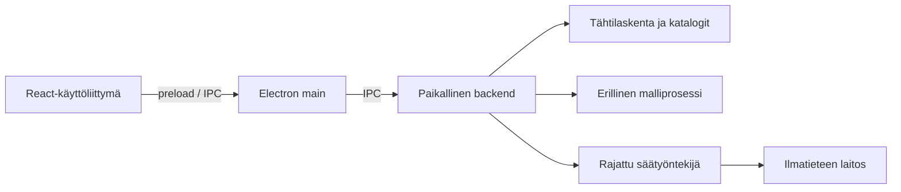

# Tähtiapuri

Tähtiapuri on kehitteillä oleva työpöytäsovellus tähtitaivaan havainnointiin.
Paikallinen kielimalli auttaa keskustelemaan siitä, mitä valitussa paikassa
näkyy nyt tai myöhemmin illalla.

Tähtiapuri on harjoitus- ja referenssiprojekti paikallisten kielimallien,
rajattujen agenttiroolien ja AI-avusteisen ohjelmistokehityksen tutkimiseen.

**Nykytila:** Electron-sovelluksessa voi keskustella paikallisen Qwen3-4B-mallin
kanssa CPU:lla tai CUDA:lla. Malli toimii erillisessä UtilityProcessissa;
käyttöliittymä käyttää rajattua IPC:tä. Asetuksista avattava stdio-MCP-kehitysyhteys
mahdollistaa erilliset mallikokeet. Paikallinen tähtikartta näyttää
valitun ajan ja paikan kohteet sekä niiden laskentakortit, mukana 5 070 tähteä.
Havaintopaikat tallentuvat paikallisesti, ja viimeksi käytetty paikka palautuu
käynnistyksessä. Karttaa voi tutkia myös ilman mallia. Sää ja kartan yhdistäminen keskusteluun
ovat seuraavia vaiheita.

## Tavoitellut ominaisuudet

- Paikallinen tähtikartta sekä Kuun, planeettojen ja tähtien kohdetiedot.
- Suomenkielinen illan katsaus ja keskustelu paikallisen kielimallin kanssa.
- Kartan ajan ja kohteen ohjaaminen keskustelusta.
- Ilmatieteen laitoksen pilvisyysennuste automaattisesti tai pyydettäessä.
- Tallennetut havaintopaikat, vaihdettava paikallismalli ja poistettava keskusteluhistoria.

Painopiste on paljain silmin havainnoinnissa. Kartta, tähtilaskenta ja
kielimalli suunnitellaan toimimaan ilman internetiä; tuore sääennuste
haetaan erikseen rajatun API-yhteyden kautta.

## Suunnitellut teknologiat

| Osa | Teknologia |
| --- | --- |
| Työpöytäsovellus | Electron ja TypeScript |
| Käyttöliittymä | React, Vite ja CSS Modules |
| Paikallinen backend | Node.js / TypeScript ja rajattu IPC-viestintä |
| Mallimoottori | node-llama-cpp / llama.cpp erillisessä UtilityProcessissa |
| Tähtikartta ja laskenta | Canvas 2D, Astronomy Engine 2.1.19 ja HYG 4.1 |
| Sää | Ilmatieteen laitoksen avoin data |

Ensimmäiset mallikokeet tehdään 4B- ja 8B-kokoluokissa. GGUF-painot
säilytetään sovelluksen ulkopuolisessa paikallisessa mallikansiossa,
ja muistissa pidetään yhtä mallia kerrallaan. 4B:n CPU-/CUDA-ajot on
todennettu kehityskokeessa. Ensimmäinen
[4B/8B-laatuvertailu](docs/experiments/model-comparison.md) on tehty;
asetusten mallinvaihto tulee myöhemmin.

## Arkkitehtuuri

Suunniteltu rakenne on paikallinen modulaarinen monoliitti. Käyttöliittymä,
sovelluslogiikka, havaintosäännöt ja ulkoisten tekniikoiden sovittimet
erotetaan toisistaan. Electron main omistaa prosessien elinkaaren ja
backend käyttötapaukset sekä mallin työkalupyyntöjen tarkistamisen.



Taivaankappaleiden tiedot tuotetaan laskennasta ja paikallisista aineistoista;
kielimalli tulkitsee ja selittää niitä. Tavoitteena on rajata ulkoinen
verkkoyhteys säätyöntekijälle. Prosessien oikeusrajat ja GPU-yhteensopivuus
varmennetaan erillisissä kokeissa.

## AI-avusteinen kehitys

Projektia suunnitellaan ja rakennetaan tekijän ja Codexin yhteistyönä.
Työ etenee yksi rajattu GitHub-issue kerrallaan: tavoite ja hyväksymisehdot,
toteutus, paikalliset tarkistukset ja dokumentointi. Kriittiset muutokset
arvioi erillinen tarkastaja-agentti.

Kehityksessä käytettävät GPT-mallit ovat eri asia kuin sovelluksen oma
paikallinen kielimalli. [Kehitysmallien työnjako](docs/ai/development-models.md)
ja [työohjeet](AGENTS.md) kuvaavat toimintatavan tarkemmin.

## Kehitys ja dokumentaatio

Windowsin PowerShellissä, projektijuuressa:

```powershell
powershell.exe -NoProfile -ExecutionPolicy Bypass -File .\scripts\dev.ps1 install
powershell.exe -NoProfile -ExecutionPolicy Bypass -File .\scripts\dev.ps1 models:prepare
powershell.exe -NoProfile -ExecutionPolicy Bypass -File .\scripts\dev.ps1 build
powershell.exe -NoProfile -ExecutionPolicy Bypass -File .\scripts\dev.ps1 start
```

[Paikallinen kehitys ja testaus](docs/development/local-development.md) sisältää
myös 4B-mallin erillisen valmistelun ja valinnaiset CUDA-kirjastot. Se kuvaa
työkaluketjun, polut ja tarkistuskomennot. [Riippuvuudet ja lisenssit](docs/legal/dependencies.md)
täydennetään toimitettavan sisällön mukaan. Ensimmäinen mallikoe käyttää
4B/8B-malleille yhteistä synteettistä aineistoa.

- [Roadmap ja työpaketit](docs/planning/roadmap.md)
- GitHub-työjono (repositoryn Issues)
- [Käyttötapaukset](docs/product/observing-session-use-cases.md)
- [Arkkitehtuuri](docs/architecture/base-architecture.md)
- [Dokumenttien hakemisto](docs/README.md)
