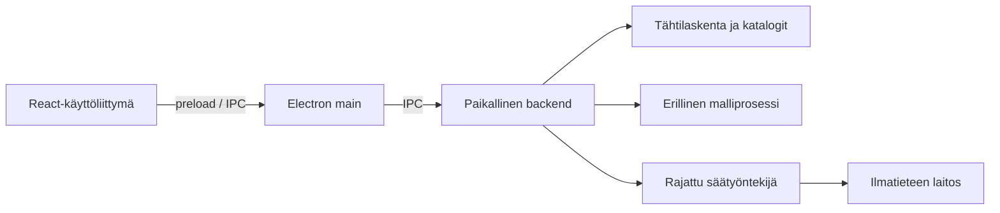

# Tähtiapuri

Tähtiapuri on suunnitteilla oleva työpöytäsovellus tähtitaivaan havainnointiin.
Paikallinen kielimalli auttaa keskustelemaan siitä, mitä valitussa paikassa
näkyy nyt tai myöhemmin illalla.

Projekti on henkilökohtainen harjoitus- ja referenssiprojekti. Sen avulla
opetellaan paikallisten kielimallien, rajattujen agenttiroolien ja
AI-avusteisen ohjelmistokehityksen käyttöä. Oppeja on tarkoitus hyödyntää
myöhemmin toisessa Electron-sovelluksessa.

**Nykytila:** suunnitteluvaihe. Repositorio sisältää arkkitehtuurin,
käyttötapaukset ja toteutusroadmapin. Ajettavaa sovellusta ei vielä ole.

## Tavoitellut ominaisuudet

- Paikallinen tähtikartta sekä Kuun, planeettojen ja tähtien kohdetiedot.
- Suomenkielinen illan katsaus ja keskustelu paikallisen kielimallin kanssa.
- Kartan ajan ja kohteen ohjaaminen keskustelusta.
- Ilmatieteen laitoksen pilvisyysennuste automaattisesti tai pyydettäessä.
- Tallennetut havaintopaikat, vaihdettava paikallismalli ja poistettava keskusteluhistoria.

Painopiste on paljain silmin havainnoinnissa. Kartta, tähtilaskenta ja
kielimalli suunnitellaan toimimaan ilman internetiä; tuore sääennuste
haetaan erikseen rajatun API-yhteyden kautta.

## Suunnitellut teknologiat

| Osa | Teknologia |
| --- | --- |
| Työpöytäsovellus | Electron ja TypeScript |
| Käyttöliittymä | React, Vite ja CSS Modules |
| Paikallinen backend | Node.js / TypeScript ja rajattu IPC-viestintä |
| Mallimoottori | llama.cpp; ensimmäiseen kokeeseen node-llama-cpp erillisessä UtilityProcessissa |
| Tähtikartta ja laskenta | D3-Celestial ja Astronomy Engine arvioitavina vaihtoehtoina |
| Sää | Ilmatieteen laitoksen avoin data |

Ensimmäiset mallikokeet tehdään 4B- ja 8B-kokoluokissa. GGUF-painot
säilytetään sovelluksen ulkopuolisessa paikallisessa mallikansiossa,
ja muistissa pidetään yhtä mallia kerrallaan. Tarkat versiot ja
yhteensopivuus ratkaistaan kokeilla.

## Arkkitehtuuri

Suunniteltu rakenne on paikallinen modulaarinen monoliitti. Käyttöliittymä,
sovelluslogiikka, havaintosäännöt ja ulkoisten tekniikoiden sovittimet
erotetaan toisistaan. Electron main omistaa prosessien elinkaaren ja
backend käyttötapaukset sekä mallin työkalupyyntöjen tarkistamisen.

Taivaankappaleiden tiedot tuotetaan laskennasta ja paikallisista aineistoista;
kielimalli tulkitsee ja selittää niitä. Tavoitteena on rajata ulkoinen
verkkoyhteys säätyöntekijälle. Prosessien oikeusrajat ja GPU-yhteensopivuus
varmennetaan erillisissä kokeissa.

## AI-avusteinen kehitys

Projektia suunnitellaan ja rakennetaan tekijän ja Codexin yhteistyönä.
Työ etenee yksi rajattu GitHub-issue kerrallaan: tavoite ja hyväksymisehdot,
toteutus, paikalliset tarkistukset ja dokumentointi. Kriittiset muutokset
arvioi erillinen tarkastaja-agentti.

Kehityksessä käytettävät GPT-mallit ovat eri asia kuin sovelluksen oma
paikallinen kielimalli. [Kehitysmallien työnjako](docs/ai/development-models.md)
ja [työohjeet](AGENTS.md) kuvaavat toimintatavan tarkemmin.

## Kehitys ja dokumentaatio

Ensimmäinen tekninen tavoite on rajattu 4B/8B-mallikoe ennen koko
käyttöliittymän viimeistelyä. Asennus- ja ajo-ohjeet lisätään ensimmäisen
ajettavan version yhteydessä.

- [Roadmap ja työpaketit](docs/planning/roadmap.md)
- [GitHub-työjono](https://github.com/Antsa46/tahtiapuri/issues)
- [Käyttötapaukset](docs/product/observing-session-use-cases.md)
- [Arkkitehtuuri](docs/architecture/base-architecture.md)
- [Dokumenttien hakemisto](docs/README.md)
