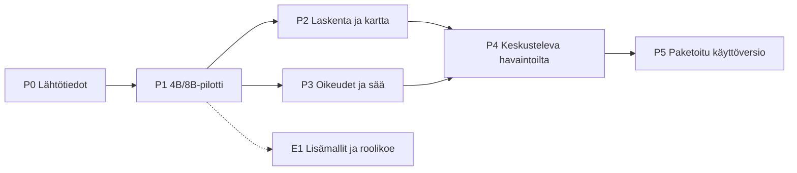

# Tähtiapurin roadmap

Tämä on koko projektin etenemisjärjestys, 3.11.2026.
Valmistelut ja toteutus etenevät issue kerrallaan. Roadmap ei ole
ajettujen kokeiden tai valmistumisen todiste. Käyttöversion rajaus on sovittu; työpakettien tarkka
jako ja kehitysmallien suositus tarkentuvat ennen niistä riippuvaa työtä.

## Tavoite ja omistajuus

Ensimmäinen hyöty on keskusteleva paikallinen tähtitaivaan apuri:
nykyhetken kartta ja yksi yhteinen katsaus, jatkokysymykset, kohdetiedot,
Ilmatieteen laitoksen sää, tallennetut paikat ja paikallinen keskusteluhistoria.
Oppimistavoite on paikallismallin ja rajattujen malliroolien toimiva käyttö
Electronissa.

- Tämä roadmap omistaa vaiheiden järjestyksen, riippuvuudet ja hyväksymisportit.
- [Käyttötapaukset](../product/observing-session-use-cases.md) omistavat käyttäjäpolut;
  [arkkitehtuuri](../architecture/base-architecture.md) ja muut aihedokumentit sopimukset.
- GitHub-issue omistaa yhden toteutustyön rajauksen, tilan ja valmistumisen näytön.
  Projects on samojen issueiden näkymä. Tähän ei kopioida niiden elävää tilaa.
- [README](../../README.md) esittelee projektin; valintojen tilan kokoaa
  [päätöshakemisto](decisions.md).
  [Kehitysmallien työnjako](../ai/development-models.md) on erillinen suositus.

Kalenteriaikataulua ei ole sovittu. Tähtiapurin vaiheet etenevät näytön
ja käytettävissä olevan ajan mukaan. Vaiheistus ei ole sovelluskoodin aloituslupa.

## Eteneminen

P2:n laskentatyötä voidaan valmistella riippumatta mallin laadusta.
P3:n selvitys aloitetaan varhain P1:n jälkeen. Havaintokäytön verkkorajaa
ei kevennetä huomaamatta, vaikka ensimmäinen yhteensopivuuskoe olisi
sovittu toteutettavaksi kevyemmässä koeympäristössä.
E1 voi edetä lähtötason jälkeen, mutta se ei estä ensimmäistä käyttöversiota.

## Työpaketit ja hyväksymisportit

Työpaketin tunniste säilyy myös GitHub-issuen otsikossa.
Alla on tavoiteltu tulos, ei toinen tehtävien tilataulu.
Yksittäinen suuri työpaketti pilkotaan ennen toteutusta pieniksi,
itsenäisesti tarkistettaviksi muutoksiksi.

### P0: Kokeen lähtötiedot ja kehitystyö

| Työ | Rajattu tulos | Edeltävä näyttö |
| --- | --- | --- |
| T00 (#1) — Ota GitHub Projects -työjono ja kehitysyhteys käyttöön | Liitä tämän repon issuet yhteen kehitystyön näkymään. | Ei toteutusriippuvuutta |
| T01 (#2) — Rajaa ensimmäinen mallikoe ja lukitse kokeen lähtötiedot | Määritä toteutuskelpoinen 4B/8B-koe ennen asennuksia ja sovelluskoodia. | Ei toteutusriippuvuutta |

**Vaiheen hyväksyminen:** Tarkka ensimmäinen toteutuspala, koeympäristö, oikeudet, versiot ja hyväksymisaineisto on sovittu. GitHub ei edellytä etä-CI:tä.

### P1: Paikallinen 4B/8B-mallipilotti

| Työ | Rajattu tulos | Edeltävä näyttö |
| --- | --- | --- |
| T02 (#3) — Pystytä Electron–backend-runko ja rajattu IPC | Käynnistä pienin desktop-runko, joka käyttää sovittua kerrosjakoa. | T01 |
| T03 (#4) — Aja hyväksytty GGUF erillisessä malliprosessissa | Kytke oikea mallisovitin backendin rajattuun työjonoon. | T02 |
| T04 (#5) — Vertaa 4B- ja 8B-malleja yhteisellä aineistolla | Hanki toistettava lähtötaso ennen laajaa käyttöliittymää. | T03 |
| T05 (#6) — Toteuta rajattu stdio-MCP-kehitysyhteys | Mahdollista kehityksen koepyynnöt saman mallisovittimen kautta. | T03 |

**Vaiheen hyväksyminen:** Todellinen malli vastaa sovelluksen oman sovittimen kautta. Vertailun ja MCP-polun näyttö on kirjattu; epäonnistuneet ja ajamattomat tapaukset erottuvat.

Kokeessa käytetään synteettisiä taivas- ja säätietoja. Tähtikartan koko
käyttöliittymää ei viimeistellä ennen mallin toimivuuden näyttöä.
Ajomoottori on erillinen prosessi; node-llama-cpp UtilityProcessissa
on ensimmäinen arviointisuunta. CPU/GPU-ajotapa, RAM/VRAM, lataus,
peruutus ja virheistä palautuminen mitataan. Kehityksen stdio-MCP
kulkee saman sovittimen ja jonon kautta. Tarkka käytäntö on
[testausohjeessa](../ai/testing-rules.md#ensimmäinen-tekninen-hyväksymiskoe).

### P2: Paikallinen tähtilaskenta ja kartta

| Työ | Rajattu tulos | Edeltävä näyttö |
| --- | --- | --- |
| T06 (#7) — Laske taivastiedot ja varmista paikallinen kohdeaineisto | Tuota kohdetiedot deterministisesti mallin selitysten pohjaksi. | T02 |
| T07 (#8) — Toteuta paikallinen tähtikartta ja kohteen valinta | Näytä kevyt todelliseen aikaan ja paikkaan sidottu kartta. | T06 |
| T08 (#9) — Tallenna havaintopaikat ja muista aktiivinen paikka | Tue muutamia nimettyjä käyttäjän määrittämiä sijainteja. | T06 |

**Vaiheen hyväksyminen:** Paikkaan ja aikaan sidottu kartta sekä kohdetiedot toimivat ilman mallia tai internetiä. Laskentaa on verrattu riippumattomiin arvoihin.

### P3: Oikeusrajat ja Ilmatieteen laitoksen sää

| Työ | Rajattu tulos | Edeltävä näyttö |
| --- | --- | --- |
| T09 (#10) — Todista prosessien verkko- ja tiedostorajaus | Valitse oikeusrajojen toteutus ja varmista se minimaalisessa koepaketissa. | T03, T05 |
| T10 (#11) — Liitä Ilmatieteen laitoksen sääsovitin ja välimuisti | Hae pilvisyystiedot rajatusti ja säilytä viimeisin onnistunut ennuste. | T08, T09 |

**Vaiheen hyväksyminen:** Verkko- ja tiedostorajojen toiminta on todennettu sovituilla prosesseilla ennen oikeaa sääverkkokäyttöä. Ennusteen lähde, ikä ja kattavuus säilyvät.

AppContainer/LPAC on avoin mekanismi. T09 sisältää varhaisen minimaalisen
paketointikokeen: desktop-runko, backend, mallimoottori, rajattu
sääkoetoiminto ja käytössä oleva MCP-sovitin. Se ei odota T14:n valmista
mallivalikkoa tai T15:n käyttöversion asenninta. Rajat osoitetaan tässä
koekokoonpanossa myös GPU-ajossa ja virheestä palautuessa.

T09a (#24) erottaa ensimmäisen synteettisen natiivikokeen:
token, koeaineiston tiedostorajat, paikalliset verkkoverrokit ja prosessien
elinkaari. [Koesuunnitelma](../experiments/windows-isolation-probe.md)
erottaa sen Electron-/malli- ja täyden minipaketin jatkoporteista.
Osakoe ei yksin täytä T09:n hyväksymisehtoja. T09b (#25) erottaa
[Electronin Node-käynnistyksen](../experiments/electron-isolation-probe.md)
yhteensopivuuden ennen SDK-/malliporttia; natiivikokeen avoimet
verkkohavainnot säilyvät erillisinä.

T15 rakentaa lopullisen asentimen, ja T16 toistaa oikeusrajojen
hyväksymisnäytön lopullisella toimitettavalla kokoonpanolla.
Pelkkä prosessijako, CSP tai työkalujen sallittujen lista ei todista
OS-eristystä. Jos varhaisen koekokoonpanon näyttö puuttuu,
sääkoe jatkuu fixtureilla. Omistaja on [turvallisuussuunnitelma](../architecture/security-and-permissions-plan.md).

### P4: Keskusteleva havaintoilta ja paikalliset tiedot

| Työ | Rajattu tulos | Edeltävä näyttö |
| --- | --- | --- |
| T11 (#12) — Yhdistä käynnistyskartta ja yhteinen illan katsaus | Toteuta sovittu ensimmäisen käyttökerran pääpolku. | T04, T07, T08, T10 |
| T12 (#13) — Ohjaa karttaa keskustelusta ja käsittele jatkokysymykset | Yhdistä keskustelu, kohteen valinta ja tulevan ajan tarkastelu. | T04, T07, T11 |
| T13 (#14) — Tallenna keskusteluhistoria ja rajaa mallin konteksti | Säilytä keskustelut paikallisesti käyttäjän poistoon asti. | T09, T11 |
| T14 (#15) — Vaihda paikallismallia asetuksista ja hallitse mallikansiota | Tue useita levyllä olevia hyväksyttyjä malleja ja yhtä ladattua mallia. | T03, T09 |

**Vaiheen hyväksyminen:** Käyttötapaukset yhdistyvät samaan paikkaan ja aikaan. Kartan ohjaus, historia, poisto ja mallinvaihto toimivat omistavien sopimusten mukaan.

### P5: Paketoitu paikallinen käyttöversio

| Työ | Rajattu tulos | Edeltävä näyttö |
| --- | --- | --- |
| T15 (#16) — Paketoi desktop ja moottori ulkoisilla mallipainoilla | Toimita Windowsissa käytettävä kokonaisuus ilman erillistä mallipalvelinasennusta. | T09, T14 |
| T16 (#17) — Varmenna käyttöversion E2E, virhepolut ja offline-käyttö | Osoita koko sovitun käyttökokonaisuuden toimivuus. | T05, T11, T12, T13, T14, T15 |
| T17 (#18) — Viimeistele käyttöohje, lisenssit ja tutkimusmuistiinpanot | Tee paikallisesta käyttöversiosta toistettava ja sen rajoista ymmärrettävät. | T04, T15, T16 |

**Vaiheen hyväksyminen:** Ohjelma toimii ilman kehitystyökaluja, hyväksytyillä ulkoisilla mallipainoilla. Koko käyttökokonaisuuden ja todellisten oikeusrajojen näyttö on olemassa.

Ohjelma ja moottori voidaan toimittaa yhdessä; koko GGUF-kirjastoa ei
paketoida. Mallit pidetään erillisessä paikallisessa kansiossa ja yksi
ladattuna kerrallaan. Päivitystapaa ei tulkita uudeksi ajonaikaiseksi
verkkoluvaksi. Aluksi riittää paikallinen, erikseen tehtävä jakelu.

### E1: Lisämallit, orkestrointi ja tutkimus

| Työ | Rajattu tulos | Edeltävä näyttö |
| --- | --- | --- |
| T18 (#19) — Vertaa lisämalleja ja yhden sekä kahden malliroolin työnkulkua | Tutki lisämallien ja delegoinnin hyöty suhteessa yhden opastajan lähtötasoon. | T04 |

**Vaiheen hyväksyminen:** Lisäkokeiden tulos erotetaan yhden roolin lähtötasosta. Mahdollinen hyöty ja rajoitukset kirjataan.

Suunniteltuja lisäverrokkeja ovat Poro, Ministral ja suurempi Qwen.
Saman 14B:n eri kvantisoinnit erotetaan 4B/8B/14B-kokovertaisuista.
Malliroolien koe vertaa yhtä opastajaa suunnittelija–opastaja-työnkulkuun.
Roolit voivat käyttää samaa mallia vuorotellen; lisärooli säilyy vain,
jos mitattu hyöty perustelee sen. Tämä ei lisää mallille verkkotyökaluja.

## Käyttötapausten jäljitettävyys

| Käyttötapaus | Ensisijaiset työpaketit | Valmistumisen näyttö |
| --- | --- | --- |
| [UC-01: käynnistys ja katsaus](../product/observing-session-use-cases.md#uc-01-käynnistys-ja-illan-katsaus) | T06, T07, T08, T10, T11 | Kartta ensin, yksi yhteinen katsaus, sää puuttuvana tai ajantasaisena. |
| [UC-02: jatkokysymys](../product/observing-session-use-cases.md#uc-02-jatkokysymys-ja-kartan-ohjaaminen) | T04, T06, T12 | Oikea konteksti, validoidut työkalut, ajan ja kartan hallittu muutos. |
| [UC-03: karttavalinta](../product/observing-session-use-cases.md#uc-03-kohteen-valinta-kartalta) | T07, T12 | Valittu kohde ja keskustelukonteksti vastaavat toisiaan. |
| [UC-04: sääpäivitys](../product/observing-session-use-cases.md#uc-04-sääpäivitys) | T09, T10 | Sallittu FMI-haku toimii; ikä, virhe ja aikakatkaisu näkyvät. |
| [UC-05: sääasetus](../product/observing-session-use-cases.md#uc-05-sääasetuksen-valinta) | T08, T10 | Valinta säilyy; ensimmäinen käynnistys on manuaalinen. |
| [UC-06: havaintopaikat](../product/observing-session-use-cases.md#uc-06-havaintopaikkojen-tallennus-ja-valinta) | T08 | Paikat säilyvät ja viimeksi käytetty palautuu näkyvästi. |
| [UC-07: keskusteluhistoria](../product/observing-session-use-cases.md#uc-07-keskusteluhistorian-käyttö-ja-poistaminen) | T13 | Säilyminen, rajattu konteksti ja poisto ilman palautumista. |
| [UC-08: mallivalinta](../product/observing-session-use-cases.md#uc-08-paikallisen-mallin-valinta) | T14, T15 | Hyväksytty ulkoinen malli vaihtuu hallitusti; yksi muistissa. |

T16 kokoaa käyttöversion hyväksymisnäytön. MCP, prosessioikeudet ja
paketointi ovat teknisiä vaatimuksia, eivät uusia käyttäjän käyttötapauksia.

## GitHubin työnjako

Repositorio on oma Tähtiapurin kokonaisuus. Julkaistavasta aineistosta
jätetään pois painot, binäärit, tunnukset, oikeat sijainnit ja keskustelut.
Julkisen aineiston rajaus tarkistetaan ennen siirtoa; käyttöönoton
tehtävätila säilyy GitHub-issueissa.

Issueen kirjataan tavoite, työalue, riippuvuudet, omistavat ohjeet,
käyttötapaukset, hyväksymisehdot ja vaadittu testinäyttö. Mallisuositus
ei muuta työistunnon asetuksia. Kriittiset toteutusmuutokset noudattavat
[erillisen tarkastajan käytäntöä](../../AGENTS.md#kehitystyön-roolit-ja-katselmus).

Projects-näkymäksi riittävät aluksi Backlog, Ready, In progress, Review ja Done.
Valmistuminen merkitään vasta sovitun näytön jälkeen. Use case -kuvausta tai
arkkitehtuurisääntöä ei kopioida kokonaisena issueen. GitHubin käyttö ei lisää
Actions-workflowita, etätestejä tai julkaisuputkea tähän projektiin.

## Päätökset ennen riippuvaa toteutusta

- Ensimmäiset tarkat 4B/8B-painot, kvantisoinnit, lisenssit, moottori ja työkaluketju.
- Mallikokeen koeympäristö ja oikeudet; havaintokäytön OS-rajan toteutus erikseen.
- Tuettu Windows-/CPU/GPU-kokoonpano ja näkyvä CPU-varatila.
- FMI-kysely, kentät, hakurajat ja ensimmäisen katsauksen odotusaika.
- Mallivalinnan ja mallikansion muistaminen sekä puuttuvan mallin käsittely.
- Arviointiaineisto ja suorituskyvyn hyväksyttävät rajat.
- Projectsia tukeva kehitysyhteys ja GitHubiin siirrettävän aineiston näkyvyys.

Vienti ja palautus, havaintopäiväkirja, laajemmat kohdejoukot ja välinetiedot
säilyvät myöhemmiksi rajattuina.
